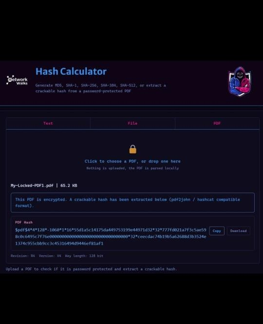
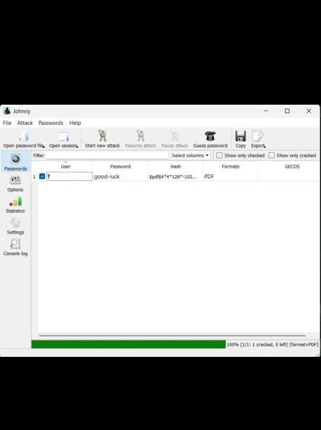
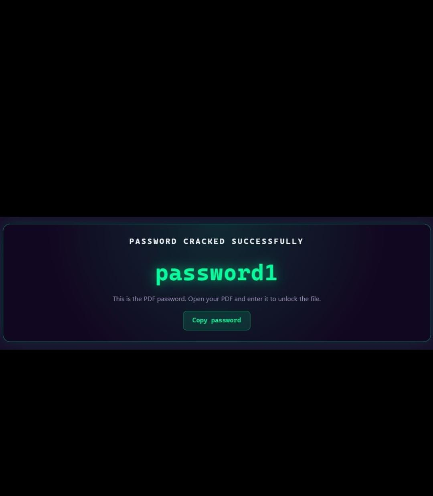

# 🔐 Password Cracking Report

### Offline PDF Password Cracking with John the Ripper (JTR)

**W3-PM · Cybersecurity · Networkwalks**

---

## 📋 Report Details

| | |
|---|---|
| 👤 **Pentester** | Abhinav Sadanandan Nair |
| 🎓 **Program / Batch** | Cybersecurity & Ethical Hacking Internship, B084-Networkwalks |
| 📦 **Module completed** | W3-PM (Password Cracking — John the Ripper) |
| 🎯 **Target** | Password-protected PDF files (provided for the exercise) |
| ✅ **Permission secured** | Yes, already granted by Networkwalks |

---

## ⚠️ Disclaimer

> [!WARNING]
> All activities were performed **only on files provided for this exercise, with permission already granted by Networkwalks.**
>
> This material is for **education and research purposes only**. Do not use anything here to break the law. Password cracking against files you do not own or have not been authorised to test is illegal in most countries. Every action you take is your own responsibility.

---

## 🔭 Overview

This week covered **offline password cracking** against encrypted PDF files. The goal was to understand how a protected PDF's password hash can be extracted and then recovered using a dictionary/brute-force attack, first with an online hash tool for a quick check, and then properly offline using **John the Ripper (via the Johnny GUI)**.

| Phase | Description | Status |
|:-----:|-------------|:------:|
| **1** | Extract a crackable hash from a locked PDF | ✅ Completed |
| **2** | Recover the password using John the Ripper | ✅ Completed |
| **3** | Capture the flag | ✅ Completed |

---

## 🧰 Tools Used

| Tool | Purpose |
|------|---------|
| 🐧 Kali Linux | Operating system used for the exercise |
| 🔑 Networkwalks Hash Calculator | Extracts a crackable hash (pdf2john / hashcat format) from a password-protected PDF |
| 🧮 `pdf2john` | Command-line alternative to extract the PDF hash for John the Ripper |
| 🐙 John the Ripper (Johnny GUI) | Cracks the extracted hash offline using a wordlist/brute-force attack |
| 🔓 Networkwalks PDF Password Cracker | Online tool used to verify a recovered password against a PDF |

---

## 🔑 1. Extracting the Hash

**Target file:** `My-Locked-PDF1.pdf` (65.2 KB)

**Command:** `pdf2john My-Locked-PDF1.pdf > pdf.hash`

The PDF was uploaded to the Networkwalks **Hash Calculator** tool, which parses it locally and confirms it is encrypted. It then extracts a crackable hash in pdf2john/hashcat-compatible format, along with the PDF's revision, version and key length (Revision 4, Version 4, 128-bit).

---

## 🐙 2. Cracking the Hash with John the Ripper

**Command:** `john pdf.hash`

The extracted hash was loaded into **Johnny**, the GUI front-end for John the Ripper. Running the attack cracked the hash in a single pass, recovering the password:

| User | Password | Format |
|------|----------|--------|
| `?` | **`good-luck`** | PDF |

The status bar confirms **100% (1/1: 1 cracked, 0 left)**.

---

## 🔓 3. Verifying with the Online Cracker

A second password-protected PDF was checked using the Networkwalks **PDF Password Cracker** tool, which confirmed the password needed to unlock the file:

| Result | Password |
|--------|----------|
| Password cracked successfully | **`password1`** |

---

## 🏁 4. Flag Captured

Unlocking the PDF revealed the flag for this module:

**Flag 1:** `nw{cybersecurity_flag_captured_2608}`

---

## 🚦 5. Risk Analysis

| # | Finding | Evidence | Potential Impact | Risk |
|:-:|---------|----------|------------------|:----:|
| 1 | Weak PDF password used | Password recovered was `good-luck` | Weak, dictionary-guessable passwords can be cracked quickly offline | 🟡 Medium |
| 2 | Common/reused password pattern | Second password recovered was `password1` | Commonly used passwords are among the first tried in any attack | 🔴 Critical |
| 3 | PDF encryption alone is not sufficient | Both PDFs were crackable once the hash was extracted | Document-level encryption provides only as much protection as the password strength | 🟡 Medium |

> [!NOTE]
> PDF password protection relies entirely on the strength of the chosen password. A weak or common password can be recovered within seconds to minutes, even with consumer hardware, once the hash is extracted.

---

## ✅ 6. Recommendations

1. 🔐 Use long, random passwords for encrypted documents, not dictionary words or common phrases.
2. 🚫 Avoid passwords like `password1` or other items found on common password lists.
3. 🧂 Where possible, use modern PDF encryption (AES-256) instead of older, weaker revisions.
4. 🔁 Rotate and avoid reusing document passwords across different files.
5. 🧪 Periodically test your own sensitive documents against cracking tools to check their strength.
6. 🗝️ Prefer a password manager to generate and store strong, unique passwords for documents.

---

## 🎓 7. Conclusion

- 🔑 A PDF's password hash can be extracted using tools like `pdf2john` or the Networkwalks Hash Calculator, without needing to know the password first.
- 🐙 John the Ripper (via Johnny) can recover weak passwords from that hash very quickly using a wordlist attack.
- 🔓 Even without a local cracking tool, online password crackers can recover weak PDF passwords in seconds.
- 🧠 This exercise highlighted how important password strength is, since encryption is only as strong as the password protecting it.
- ⚖️ Password cracking must always be performed only on files you own or are authorised to test.

---

## 📁 Repository Contents

| File | Description |
|------|-------------|
| `README.md` | This file |
| `1000325570.jpg` | Hash Calculator extracting the crackable hash from the locked PDF |
| `1000325572.jpg` | John the Ripper (Johnny GUI) cracking the hash — password `good-luck` |
| `1000325569.jpg` | Online PDF Password Cracker result — password `password1` |
| `1000325571.jpg` | Flag captured screen |

---

## 👤 Author

**Abhinav Sadanandan Nair**
Cybersecurity & Ethical Hacking Internship · Networkwalks (Batch B084)

⭐ *If you found this useful, consider starring the repo!*

